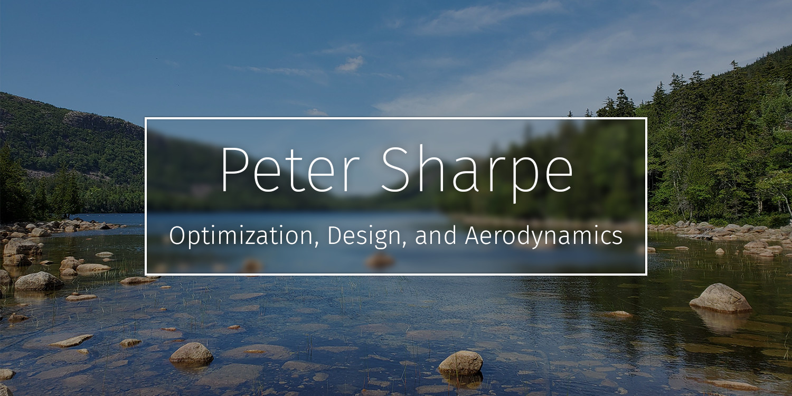

-----

Hello there! My name is **[Peter Sharpe](https://www.linkedin.com/in/peterdsharpe/)**, and I'm a researcher and engineer at [NVIDIA](https://www.nvidia.com/). :computer::atom::ocean::tornado:🍃 

There, I develop new techniques for modeling *physical systems governed by [partial differential equations (PDEs)](https://en.wikipedia.org/wiki/Partial_differential_equation)*, such as [aerodynamics, weather forecasting, heat transfer, structures, etc.](https://developer.nvidia.com/physicsnemo), using combinations of classical and machine learning (ML) methods. 

* My current research develops and scales new ML model architectures that respect [symmetries of physics](https://en.wikipedia.org/wiki/Symmetry_(physics)) (e.g., translation-, rotation-, and parity-equivariance; invariants like energy/momentum; discretization- and units-invariance) and PDE information flow (e.g., global information propagation for elliptic PDEs). I think incorporating these physics-based pieces into ML model architectures is critical to achieve practical levels of generalization capability.
* Recent work:
  * [GLOBE](https://arxiv.org/abs/2511.15856) (NeurIPS 2026): a neural surrogate built like a boundary-element method, with exact physical symmetries. [Code](https://github.com/NVIDIA/physicsnemo).
  * [ISLA](https://arxiv.org/abs/2611.17141): a coordinate-free transformer for boundary-driven PDEs, whose answer rotates and moves with the problem and stays the same when it is re-meshed or re-scaled.
  * [AeroZoo](https://huggingface.co/datasets/nvidia/AeroZoo): a public benchmark of 3,815 well-posed CFD problems, co-led with Carmelo Gonzales ([paper](https://arxiv.org/abs/2611.17152)).
  * [PhysicsNeMo-Mesh](https://docs.nvidia.com/physicsnemo/latest/user-guide/mesh.html): GPU-accelerated, differentiable mesh processing for physics-AI ([paper](https://arxiv.org/abs/2610.39072)).
  * Lead maintainer and release manager of [pytorch/tensordict](https://github.com/pytorch/tensordict).

Papers: [Google Scholar](https://scholar.google.com/citations?user=2nHAAw8AAAAJ)

More broadly, I'm interested in any and all things scientific computing and applied math!

-----

Before that, I was a PhD Candidate at [MIT AeroAstro](https://aeroastro.mit.edu/) studying aircraft design, multidisciplinary design optimization (MDO), and computational aerodynamics. :rocket::airplane:🚁 

I did [my PhD research](https://dspace.mit.edu/handle/1721.1/157809) on developing [new optimization techniques that allow us to quickly solve challenging real-world engineering problems](https://github.com/peterdsharpe/AeroSandbox) - it was a ton of fun. Some general ideas in my work:
* I'm a strong advocate of "interactive design" - *design optimization must be an exploratory process with a human at the wheel*, because 90% of design is asking the right question. Unfortunately, many traditional design optimization tools ("black-box optimizers") at an acceptable level of modeling fidelity are too slow for interactive use - an optimizer that takes hours, days, or weeks to run is generally not very useful.
* Most of my optimization research focuses on enabling rapid, interactive design through automatic differentiation and "simultaneous analysis and design" (SAND) methods. Both of these require you to "get inside of the black box" of solvers, and the payoff is that design optimization of highly-coupled systems becomes many orders of magnitude faster.
* Generally, my work focuses on "wide" rather than "deep" design optimization: when designing complex engineering systems, I've found that [it's usually more important to capture the rough design trade-offs across dozens of subsystems, rather than precisely analyzing just one or two disciplines](https://github.com/peterdsharpe/transport-aircraft). When precision is required, [surrogate modeling techniques based on data from high-fidelity analysis and occasionally machine learning](https://github.com/peterdsharpe/neuralfoil) can allow us to retain both high speed and high accuracy.

-----

**Welcome to my GitHub!** Come in. Have some tea. Stay a while. 🙂

-----
Note:
*The background photo up top is from a hike I did in Acadia National Park - I'd highly recommend going if you're in the area!*
